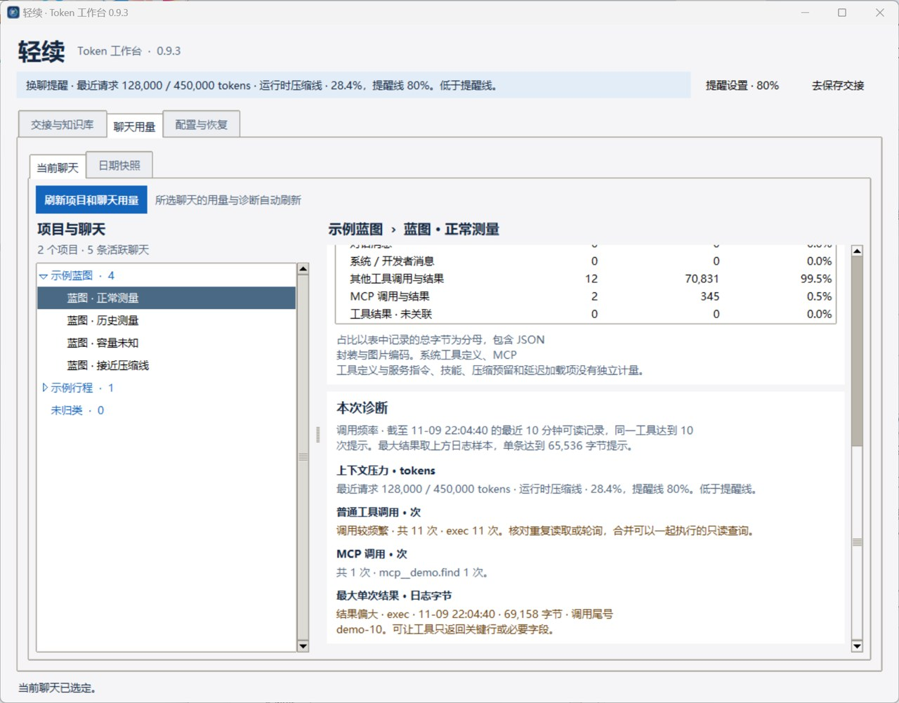

# 轻续 Qingxu · Codex Token 工作台

轻续是面向 Codex 桌面端用户的 Windows 本地工具。它按项目和聊天解释 token 用量，提醒你何时检查上下文，并生成旧聊天收尾和同项目新聊天接续的指令。

**当前版本** 0.9.3 · Windows x64 分享预览版

[Windows x64 便携 ZIP](releases/Qingxu-0.9.3-Windows-x64.zip) · [单文件 EXE](releases/轻续.exe) · [UI 与源码交接 ZIP](releases/Qingxu-UI-Handoff-0.9.3-20261109.zip)



## 快速开始

1. 下载并解压便携 ZIP，双击 `轻续.exe`。程序自带运行环境。通过 GitHub 文件页面获取时，点击 **Download raw file**。
2. 在「聊天用量 → 当前聊天」选择 Codex 项目和聊天。查看最近请求、聊天累计、内容来源和诊断。顶部提醒默认在 80% 提示，可调整或暂停。
3. 想换聊时，在「交接与知识库」复制保存指令给旧聊天。把返回的短摘要粘贴到「交接摘要」，核对后将恢复指令发到同项目的新聊天。
4. 要试用「配置与恢复」，先选 `config.toml` 的副本。读取后勾选字段、预览、确认应用。工作台备份原文件并读回，恢复时会检查目标是否已有其他改动。

## 三个工作区

| 页面 | 功能 |
| --- | --- |
| 聊天用量 | 从本机可识别的日志读取选中聊天。最近请求、同聊累计、工具调用次数和内容来源的日志字节各有口径。可选的日期快照读取已有 ccusage 增量统计。 |
| 交接与知识库 | 分享版默认生成手动接力指令，由使用者选择发送和换聊。普通 Markdown 文件夹可用，私有短断点、Obsidian 映射和快照采集需分别配置。 |
| 配置与恢复 | 核对文件值和模型目录参考，比较继承、推荐和自定义方案。对选中的 TOML 字段执行预览、备份、确认、写后读回及冲突检查。 |

## 本机数据与权限

轻续默认读取当前 Windows 用户的 `%USERPROFILE%\.codex`，支持 `CODEX_HOME`。需要隔离时可用 `QINGXU_CODEX_HOME` 指定单独的数据目录。EXE 的偏好、日志和配置备份默认保存在 `%LOCALAPPDATA%\Qingxu`，源码启动保存在 `work/qingxu/data`。配置备份可能含凭据，应留在本机。

用量来自可识别的本机样本。缺失显示未知，日志字节、会员额度和账单各有独立口径。配置页的写后读回确认文件内容，Codex 运行时是否采用需要另行验收。

## 从源码运行

在仓库根目录使用带 Tk 的 Python 3.11 或更高版本。下面的合成演示会在新的临时目录生成样本，打开窗口后可以体验三页。

```powershell
$demoRoot = Join-Path $env:TEMP ('Qingxu-Demo-' + [guid]::NewGuid().ToString('N'))
py -3 -B .\tools\demo-current.py --root $demoRoot
```

将 `--check` 加到演示命令末尾可核对 Tk 启动、合成聊天和请求去重后退出。需要读取本机 Codex 数据时，从仓库根目录运行 `py -3 -B .\work\qingxu\launch.pyw`。

运行当前源码的相关回归：

```powershell
Push-Location .\work\qingxu
try { py -3 -B -m unittest test_context_usage test_dashboard test_relay test_app.ConfigTests }
finally { Pop-Location }
```

## 项目资料与验收

| 入口 | 内容 |
| --- | --- |
| [START-HERE.md](START-HERE.md) | 接手顺序、当前基线和验收边界 |
| [项目背景](docs/PROJECT-BACKGROUND.md) | 产品需求、技术路线和优先级 |
| [work/qingxu/](work/qingxu/) | 当前维护的 Python/Tk 源码、使用细节和测试 |
| [离线 UI 报告](docs/ui-handoff-0.9.3/index.html) | 0.9.3 冻结截图、控件回调、指标定义和验证记录。下载交接 ZIP 后在本地打开。 |
| [0.9.3 复现与打包](docs/ui-handoff-0.9.3/RUN.md) | 冻结源码的合成演示、测试、PyInstaller 打包和可选集成 |

0.9.3 的冻结记录包括 27 张使用合成或空白数据的原生 Tk 截图、49 项相关回归、配置副本的冲突与恢复、私有断点版本保存和读回，以及解压启动和重建。真实新聊接续、配置运行时采用、实际知识库写回、真实采集器启停和跨线程 fork 用量对账仍待验。Token 节省比例需要同任务对照。 [冻结验收记录](docs/ui-handoff-0.9.3/manifest.json)

## 许可

轻续沿用 Codex Pocket 的 MIT 许可，保留原版权声明。便携包附带打包依赖的许可证。 [MIT 许可](LICENSE) · [源码来源](work/qingxu/provenance.json) · [第三方许可证](docs/ui-handoff-0.9.3/source/licenses/)
