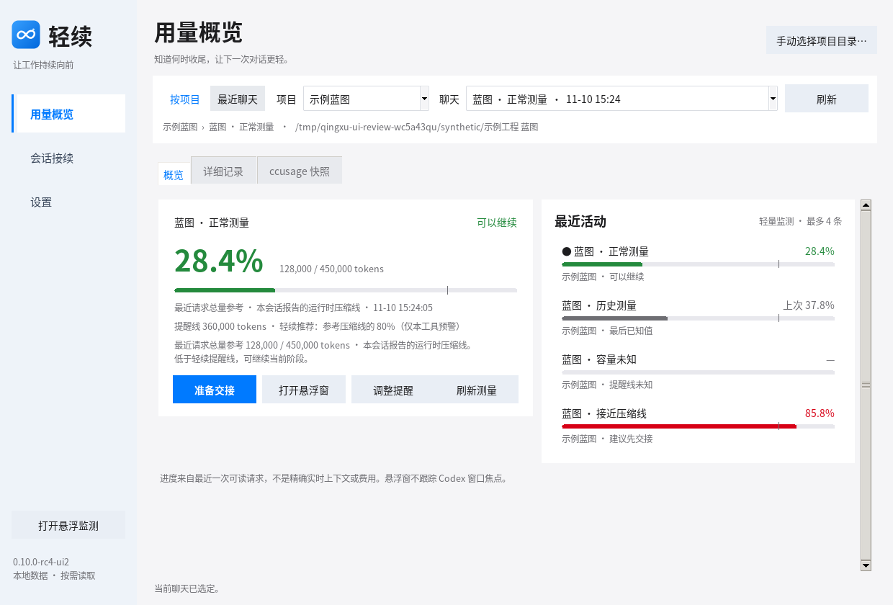

# 轻续 Qingxu · Codex Token 工作台

轻续是一个 Windows 本地工作台。它按项目和聊天呈现本机 Codex 的用量参考，提醒何时整理上下文，并把短交接保存为可在新会话读回的 Markdown。

**本包源码候选** 0.11.0-billing-rc3 · 按时间范围展示用量统计。

**本轮 Windows x64 便携包** 已由本源码构建，安装说明见 `install/README.md`。

计费入口：**用量概览 → 计费统计**。用量按今天、近 7 天、近 30 天、全部统计，所有项目合并；先运行 `Preview-Billing.cmd` 体验合成数据。[计费使用指南](docs/BILLING-USER-GUIDE.md) · [计费工程交接](docs/BILLING-HANDOFF.md) · [图文验收](docs/billing/SCREENSHOTS.md)。

本地 Token 成本估算与来源报告金额分开；不等于订阅或供应商实际账单。

这版统一主窗、模板弹窗和悬浮窗的双环标识。按钮通过颜色反馈点击，精简悬浮窗按字体和内容调整大小。设计素材与状态映射见 [Apple UI v2](docs/design/apple-ui-v2/README.md)。

[Windows 安装包目录](https://github.com/Jovifei/Token_dishboard_codex/tree/main/install) · [下载便携 ZIP](https://github.com/Jovifei/Token_dishboard_codex/blob/main/install/Qingxu-0.10.0-rc4-ui2-Windows-x64.zip) · [本机验收结果](docs/verification/0.10.0-rc4-ui2/README.md)



## 快速开始

1. 下载便携 ZIP 并完整解压，运行 `轻续.exe`。在 GitHub 文件页面可用 **Download raw file**。
2. 正常启动会列出本机 Codex 项目和聊天。使用自定义数据位置时，可在「设置 → 目录与提醒」调整。无知识库时可以直接接续。
3. 在顶部选择项目和聊天。「用量概览」显示最近请求参考、来源和四条最近活动。按需打开悬浮窗。
4. 在「会话接续」把旧聊指令发给所选会话，粘贴或导入摘要。默认可直接复制带摘要的指令，发送给同项目的新聊。需要留档或用文件引用时，保存为 Markdown。
5. 在「Codex 配置」确认目标文件并选择数值方案，再调整压缩、输出及主/子 Agent。勾选后先预览，再备份并应用。轻续提醒与 Codex 自动压缩参数分别保存。

## 数据与边界

- 最近请求、聊天累计、日志字节、ccusage 快照各有口径。未知、过期、真实零和压缩后待测分别展示。悬浮窗跟随轻续所选或本机记录的最近活动。
- EXE 默认在 `%LOCALAPPDATA%\Qingxu` 保存自己的偏好、备份和日志，源码默认使用 `work/qingxu/data`。可用 `QINGXU_DATA_DIR` 隔离轻续数据，用 `QINGXU_CODEX_HOME` 指定初始 Codex 来源。更换绑定目录无需迁移已有文件。
- 摘要校验所选项目、工作路径、来源会话和哈希。文件引用要求新会话具备读取交接文件的权限。携带摘要可以直接在提示词中恢复任务状态。
- 普通 Markdown、Obsidian 和 ccusage 是可选接入。项目知识模板按勾选的分类创建缺失文件。消息由使用者发送，知识更新受实际授权约束。配置备份可能含凭据，应留在本机。

## 从源码运行

在仓库根目录使用带 Tk 的 Python 3.11 或以上版本。双击 `Preview-Demo.cmd` 可先体验标为「合成演示」的窗口，`Preview-Billing.cmd` 体验计费页，`Start-Qingxu.cmd` 启动真实数据入口。

```powershell
$demoRoot = Join-Path $env:TEMP ('Qingxu-Demo-' + [guid]::NewGuid().ToString('N'))
py -3 -B .\tools\demo-current.py --root $demoRoot --check
.\Test-Windows.cmd
```

Windows x64 构建使用 [锁定依赖](tools/requirements-build.txt)。在已安装该依赖的 Python 环境运行 `py -3 -B .\tools\build-windows.py --output <新目录>`，或使用 `Build-Windows.cmd <新目录>`。

## 项目资料

- [使用指南](docs/USER-GUIDE.md) · [计费使用指南](docs/BILLING-USER-GUIDE.md) · [接手入口](START-HERE.md) · [工程交接](docs/ENGINEERING-HANDOFF.md)
- [rc3 Windows 验收](docs/verification/0.11.0-billing-rc3/README.md)
- [验证记录](docs/VERIFICATION.md) · [本机清单](docs/LOCAL-ACCEPTANCE.md) · [界面与交互规范](docs/UX-SPEC.md)
- [UI2 增量交接](docs/UI-REVISION-HANDOFF.md) · [rc3 本机复验](docs/verification/0.10.0-rc3/README.md)
- [rc1 远端 UI 截图与设计对照](docs/ui-handoff-0.10.0-rc1/index.html) · [0.9.3 冻结基线](docs/ui-handoff-0.9.3/index.html)
- [rc2 源码与本机验收包](https://github.com/Jovifei/Token_dishboard_codex/blob/main/releases/Qingxu-0.10.0-rc2-Local-Acceptance.zip)
- [0.9.3 Windows x64 便携版](https://github.com/Jovifei/Token_dishboard_codex/blob/main/releases/Qingxu-0.9.3-Windows-x64.zip) · [MIT 许可](LICENSE) · [源码来源](work/qingxu/provenance.json)
