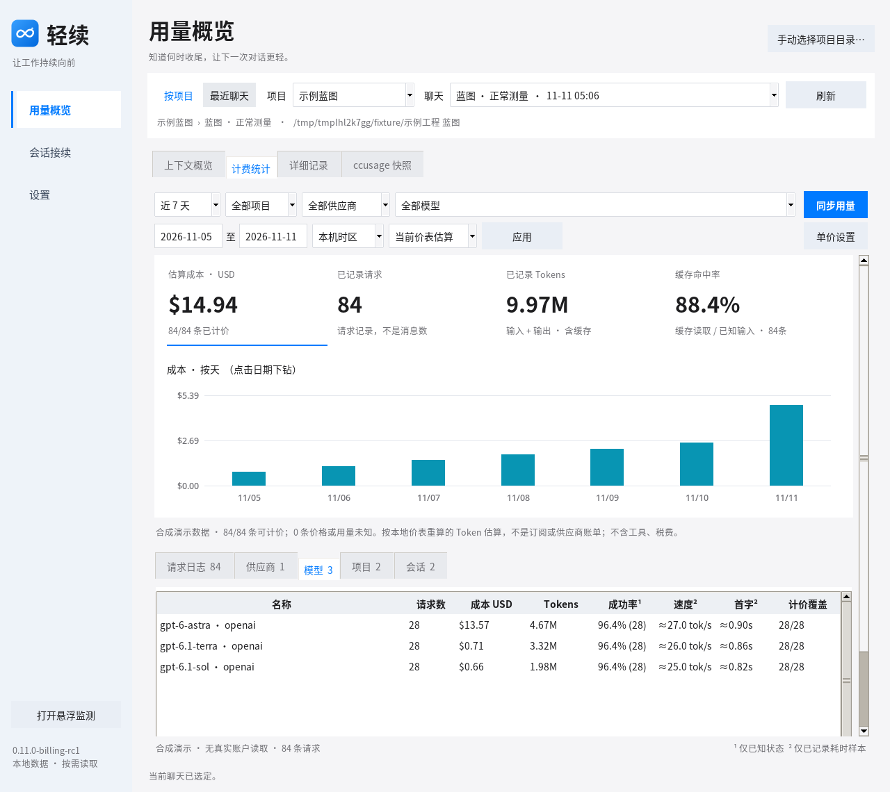
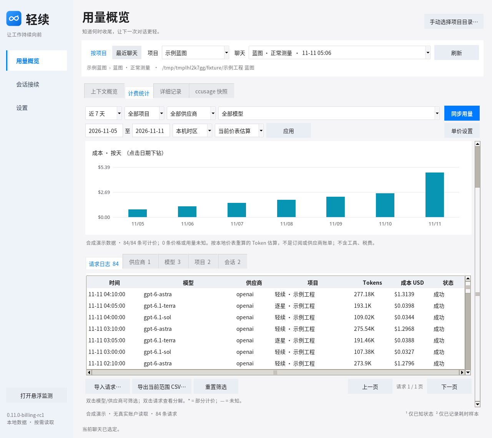
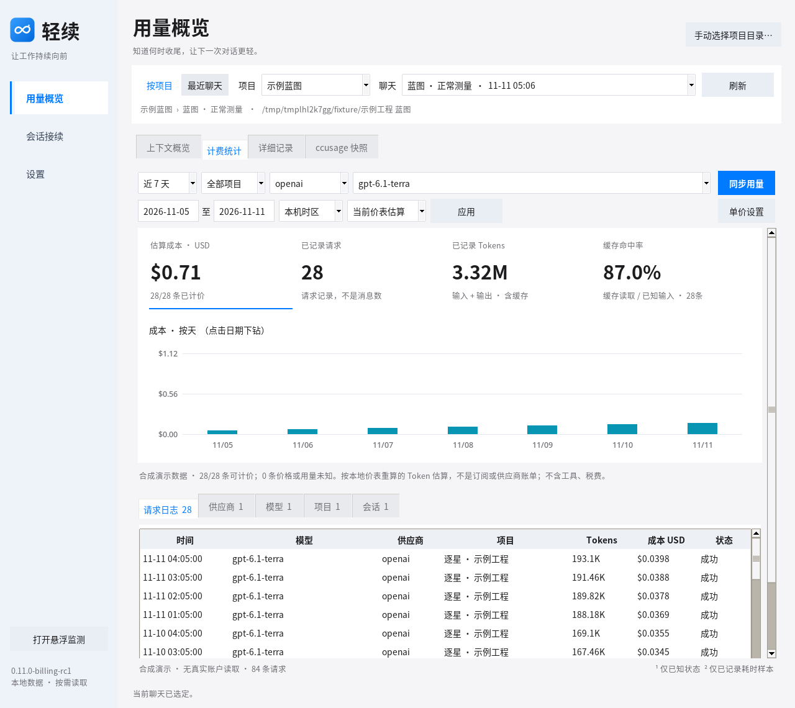
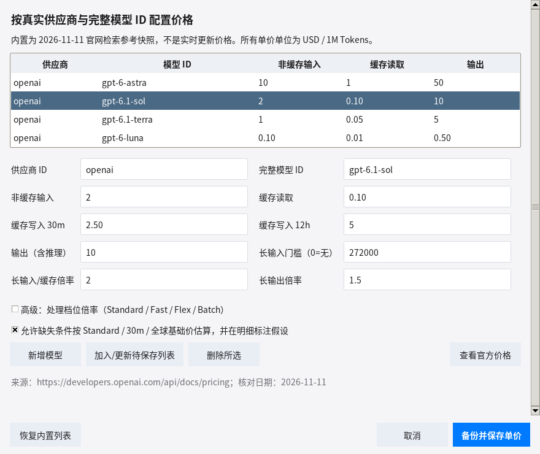
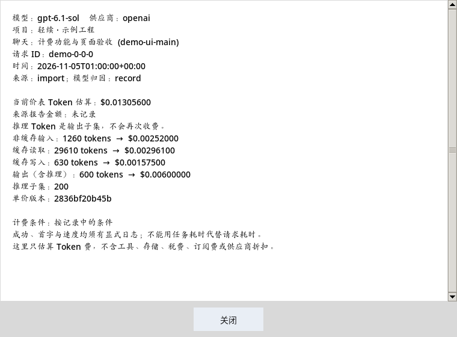
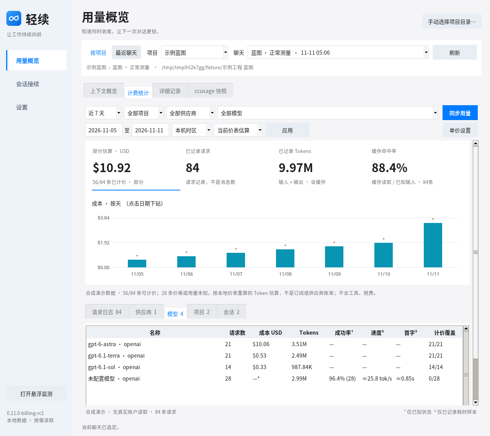
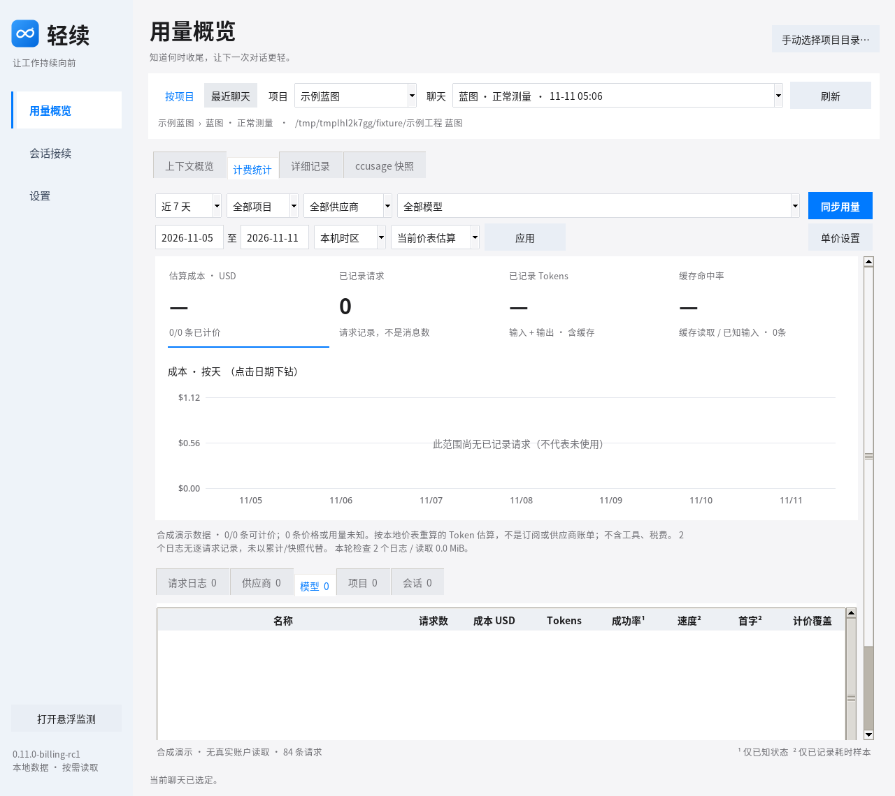
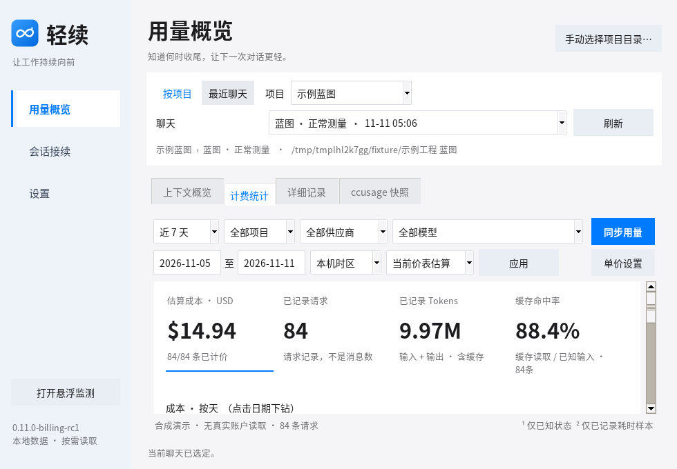
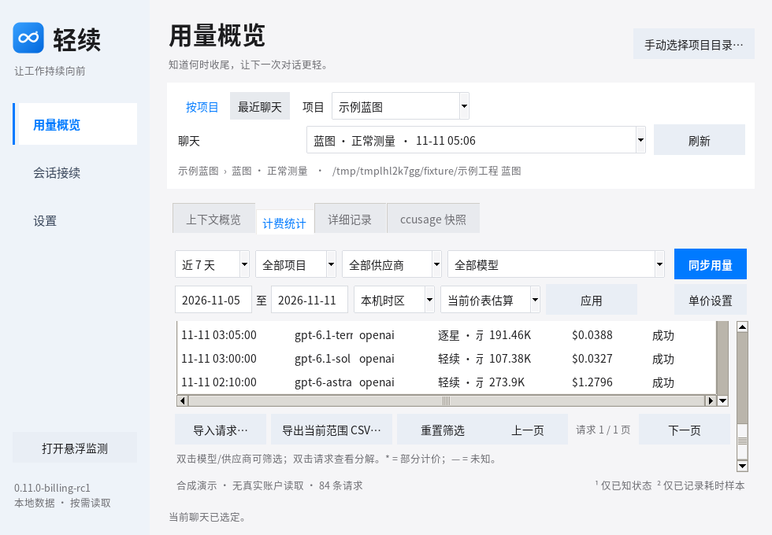

# 轻续 0.11.0-billing-rc1 · 计费统计界面

这组图片来自 **隔离合成数据** 的 Tk 页面截图，不是任何真实用户的账单。

实现基于 `main@2f53b196`，新功能入口：**用量概览 → 计费统计**。界面上的金额属于本地根据单价和 Token 明细计算的估算，**不等同于实际付款或订阅费用**。

## 概览与筛选

## 自定义单价及异常状态

## 窄窗口可用性

更多使用步骤见 [计费使用指南](../BILLING-USER-GUIDE.md)，价格及请求格式见 [PRICING-SOURCES.md](PRICING-SOURCES.md) 和 [REQUEST-SCHEMA.md](REQUEST-SCHEMA.md)。