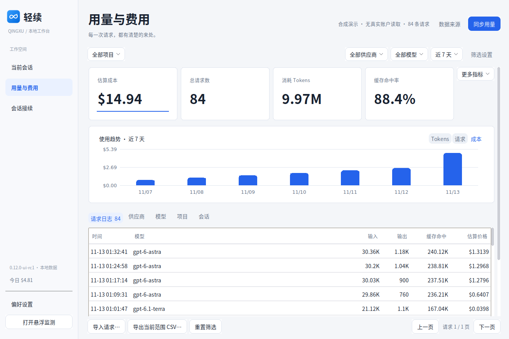
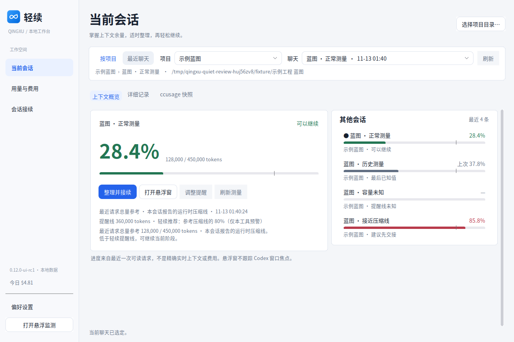
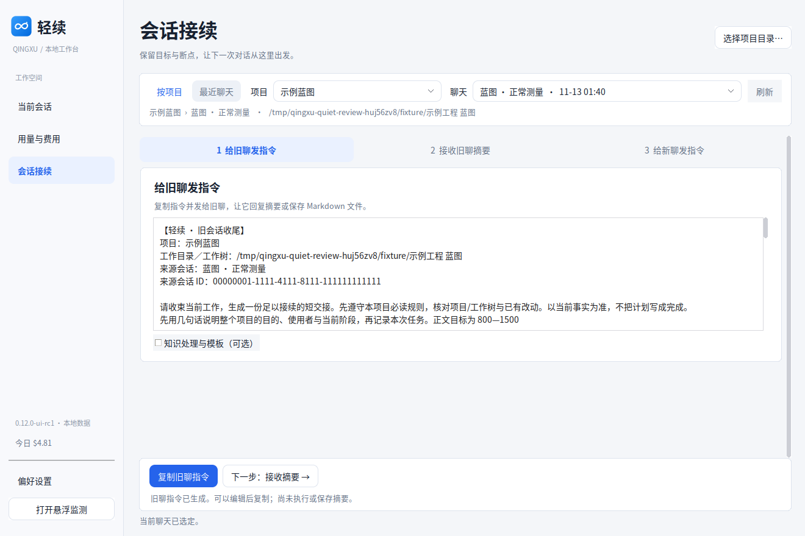
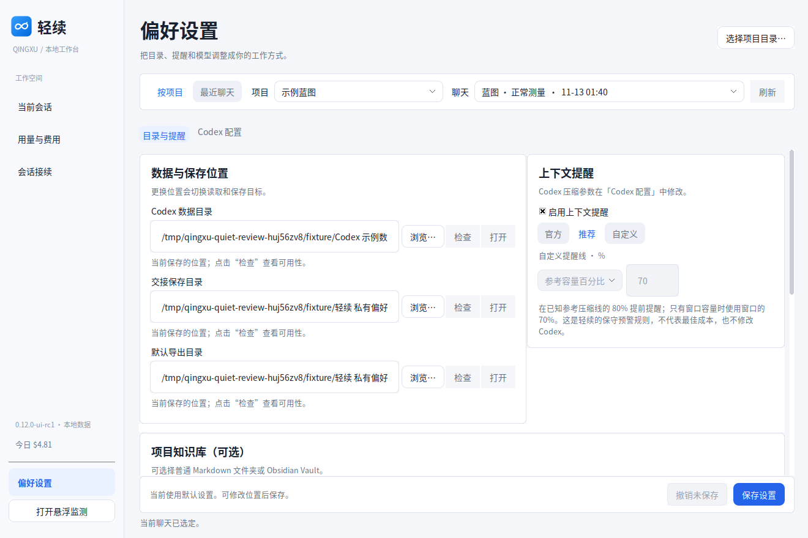
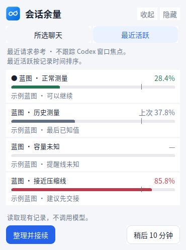
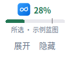
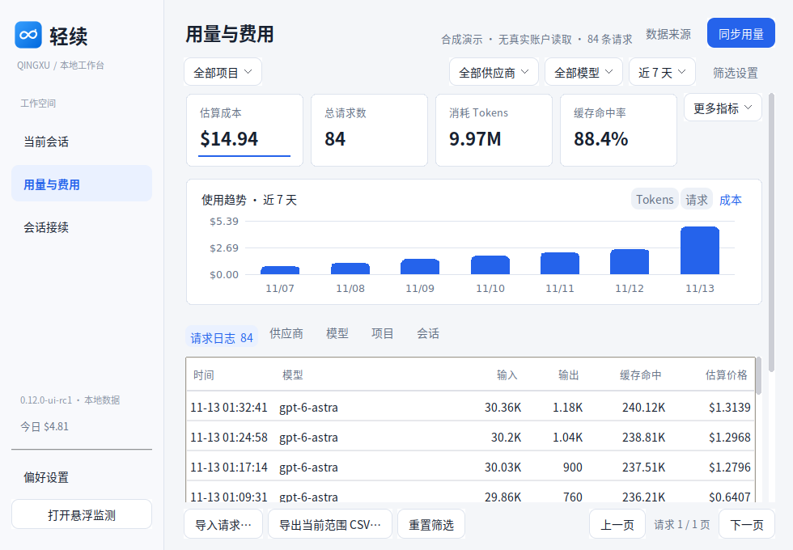
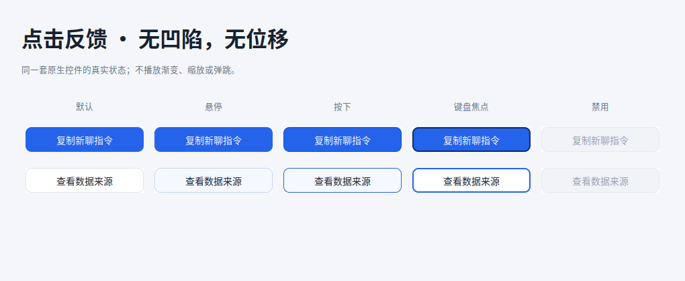

# 轻续 Quiet UI · 0.12.0-ui-rc1

基于 2026-11-13 拉取的 `main@f26dddb`（0.11.3-rc1），不是旧 ZIP。保留独立用量统计、分钟级时间筛选、完整历史、压缩日志适配、项目身份修复、会话接续、知识绑定、配置回滚与浮窗。

## 从任务重新安排界面

| 用户要做什么 | 入口 | 主要操作 |
|---|---|---|
| 看当前上下文压力 | 当前会话 | 选项目/聊天 → 看余量和提醒依据 → 整理并接续 |
| 看消耗和估算 | 用量与费用 | 时间/项目/供应商筛选 → 图表和请求 → 固定底栏导出 |
| 让新聊接着做 | 会话接续 | 旧聊指令 → 接收摘要 → 新聊指令，保留原校验和未保存保护 |
| 按自己的环境使用 | 偏好设置 | 目录、可选知识库、提醒、主/子 Agent 配置 |

统计页不带无关的全局会话选择器；其他页共享原项目和会话身份。未知值不填零，估算成本明确标注，点击复制不等于外部执行完成。

## 设计系统与点击契约

`work/qingxu/ui_quiet.py` 集中定义背景、文字、边框、强调色、间距和原生 ttk 的状态面。银灰画布、白色分组、低饱和边框、蓝色主操作；信息按标题、数值、操作、依据分层。保留原双环品牌。

**本版不播放点击动画。** 主按钮悬停时保持底色；按下只显示边界反馈。无凹陷、暗色下压、白色闪烁、缩放、位移、水波纹、自动呼吸。所有状态的坐标与尺寸相同。键盘焦点有单独描边；禁用不可触发；按下后拖出控件再松开取消动作；内部松开仍沿用 ttk 原生单次回调。旧 `ui_motion.py` 保留兼容测试，但新工作台不挂载旧的渐变控制器。

圆角控件使用小型标准库 PNG 状态面，不引入运行依赖。分组的圆角是独立装饰 Canvas，采用 place 放在原生控件背后，不参加尺寸协商，避免控件重排循环。文本输入、组合选择、IME、剪贴板、确认和文件选择仍为原有原生行为。

窄/低窗口自动降低统计卡片密度，保留请求首行。普通窗口导入/导出/翻页固定在底部；极短窗口改为随正文滚动，以免操作栏挤没内容。

## 图文验收

以下是实际运行截图，不是 Figma 稿或 HTML 模拟。数据均为合成示例，金额不代表用户账户。

## 验证与接手

本地运行 `Test-Windows.cmd`，或在 Linux Tk 显示环境运行 `python tools/run-windows-tests.py --result result.json`。新增 `test_ui_quiet.py` 覆盖状态尺寸、原生单次激活、拖出取消、禁用、装饰无布局影响、资源复用和旧动效隔离。旧导航顺序测试随明确的新导航顺序调整，数据/安全与窗口可达性测试未降低标准。

`python tools/capture-quiet.py` 可重新采集截图（仅此开发工具依赖 Pillow）。测试记录保存在 `docs/verification/0.12.0-ui-rc1/`。Linux Xvfb 不能证明 Windows 任务栏、读屏、原生对话框与真实 DPI；本版本没有新的 Windows EXE。`install/` 中的旧安装包不应标成此候选版本。真实订阅/账单、外部 Codex 配置采用与知识写回仍是独立验收事项。

设计参考：Apple Human Interface Guidelines 的 [Buttons](https://developer.apple.com/design/human-interface-guidelines/buttons)、[Layout](https://developer.apple.com/design/human-interface-guidelines/layout) 与 [Feedback](https://developer.apple.com/design/human-interface-guidelines/feedback)。不声称这是 macOS 原生控件或完成的 Figma 在线设计。
